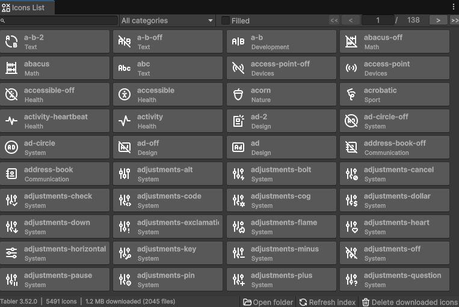

# Editor icons

The Core package gives your editor tools access to more than 5,000 icons from [Tabler Icons](https://tabler.io/icons), for IMGUI and UI Toolkit.

No icon is shipped with the package: icons are downloaded the first time they're used, then stored in a folder shared by every project and Unity version on your machine. So each icon is downloaded only once, and adding icons to your tools doesn't add any file to your project.

> Tabler's style is meant for tools, so these icons are only available in the editor (in the `SideXP.Core.EditorOnly` namespace), not in builds.

## Finding an icon

Open `Tools > Sideways Experiments > Viewers > Editor Icons` to browse the available icons:

- Search by name or keywords: every word must be found in the icon's name or tags, so `arrow left` finds `arrow-left`, and `house` finds `home`.
- Filter by category, or only list the icons that exist in the filled style with the *Filled* checkbox.
- Click an icon to copy its name.



The status bar shows the Tabler version of the icons index, the size of the downloaded icons, and buttons to open their folder, refresh the index or delete the downloaded icons.

You can also browse the icons on the [Tabler website](https://tabler.io/icons): the names are the same.

## Using icons with IMGUI

Use `EditorIcons.GetIcon()` to get an icon as a `Texture2D`:

```cs
using UnityEditor;
using UnityEngine;
using SideXP.Core.EditorOnly;

public class MyToolWindow : EditorWindow
{
    private void OnGUI()
    {
        Rect iconRect = GUILayoutUtility.GetRect(16, 16, GUILayout.ExpandWidth(false));
        GUI.DrawTexture(iconRect, EditorIcons.GetIcon("home"));

        if (EditorIcons.IconButton("refresh", new GUIContent("Refresh", "Reload the data.")))
            Debug.Log("Refresh clicked");
    }
}
```

`GetIcon()` never returns null. If the icon is not downloaded yet, it returns a placeholder of the same size (the first frame of Unity's loading spinner), and starts the download. The editor views are repainted once the icon is there, so the next call returns it. A name that doesn't exist logs a warning (once per name), and returns a transparent placeholder.

> Call `GetIcon()` each time you draw: it's cheap, and that's how the placeholder is replaced by the icon once it's downloaded. Don't keep the returned texture in a field, and don't destroy it: textures are owned by the icon system.

### Icons in `GUIContent`

`EditorIcons.IconContent()` makes a `GUIContent` with an icon, for any IMGUI control. IMGUI draws the image of a `GUIContent` at its size in pixels, as if it was in points. Icon files have more pixels on high display scales to stay sharp (32 pixels for a 16 points icon at 200%), so draw the content in an `IconSizeScope` to keep the icon at its size on screen:

```cs
using (new IconSizeScope(EIconSize.Small))
{
    GUILayout.Label(EditorIcons.IconContent("folder", "Output folder"));
    GUILayout.Button(EditorIcons.IconContent("trash", "Delete", "Delete the generated files."), EditorStyles.toolbarButton);
}
```

`EditorIcons.IconButton()` does that for you, for buttons drawn with the default button style.

### Styles, colors and sizes

Every function of `EditorIcons` takes the same optional parameters:

```cs
Texture2D icon = EditorIcons.GetIcon("star", EIconStyle.Filled, EIconColor.White, EIconSize.Large);
```

| Parameter | Values | Default |
|---|---|---|
| `EIconStyle` | `Outline`, `Filled` | `Outline`. Available for every icon. `Filled` falls back to `Outline` for the icons that have no filled version. |
| `EIconColor` | `Auto`, `White`, `Black` | `Auto`: white on the dark editor theme, black on the light one. |
| `EIconSize` | `Small` (16 points), `Medium` (24 points), `Large` (32 points) | `Small`: the size of Unity's own icons, which fits in a single inspector line and in toolbars. |

Sizes are in points, the unit of editor layouts. The icon file is chosen from that size and the display scale, so icons stay sharp at 100%, 150% or 200%. `EditorIcons.GetPointSize()` gives the size of an icon on screen.

> To tint an icon in IMGUI, use the `White` color with `GUI.color`. `GUI.color` also tints the text of the control, so prefer `Auto` for controls with text.

### Waiting for an icon

If your code needs to know when an icon is ready (as to cache a value computed from it), use `TryGetIcon()` or `LoadIcon()`:

```cs
// Returns false (and starts the download) if the icon is not available yet
if (EditorIcons.TryGetIcon("home", out Texture2D icon))
    _cachedIcon = icon;

// Calls back right away if the icon is available, or once it's downloaded
EditorIcons.LoadIcon("home", loadedIcon => _cachedIcon = loadedIcon);
```

The `LoadIcon()` callback is called on the main thread. It's not called if the icon doesn't exist or can't be downloaded.

### Listing the icons

`EditorIcons.Icons` lists the informations about all the icons (`Name`, `Category`, `Tags` and `HasFilled`), and `EditorIcons.Categories` lists the category names. Use `EditorIcons.Exists()` to check if an icon exists in a given style.

These lists are empty until the icons index is downloaded (see [Where icons come from](#where-icons-come-from)): use `EditorIcons.IsIndexAvailable` to check it.

## Using icons with UI Toolkit

The `Icon` element displays an icon in UXML, in UI Builder, or from code. It shows the loading placeholder until the icon is downloaded, then updates itself.

```xml
<ui:UXML xmlns:ui="UnityEngine.UIElements" xmlns:sxp="SideXP.Core.EditorOnly">
    <sxp:Icon icon="home" />
    <sxp:Icon icon="star" icon-style="Filled" icon-color="White" icon-size="Large" />
</ui:UXML>
```

In UI Builder, you'll find it in the *Library* panel, with the other custom controls of your project, under `SideXP.Core.EditorOnly`.

From code, create it with its constructor, or change its properties at any time:

```cs
var icon = new Icon("home", iconSize: EIconSize.Medium);
root.Add(icon);

icon.IconName = "user";
icon.SetIcon("star", EIconStyle.Filled, EIconColor.White, EIconSize.Large);
```

| UXML attribute | Property | Default |
|---|---|---|
| `icon` | `IconName` | None: the element is empty. |
| `icon-style` | `IconStyle` | `Outline` |
| `icon-color` | `IconColor` | `Auto` |
| `icon-size` | `IconSize` | `Small` |

### Styling the element

The element sets its own width and height from its size, so USS `width` and `height` rules don't apply to it. To use another size, set the `--sxp-icon-size` custom property, in points. The element has the `sxp-icon` USS class, plus `sxp-icon--small`, `sxp-icon--medium` or `sxp-icon--large` depending on its size, so you can target them:

```css
.my-toolbar .sxp-icon--small {
    --sxp-icon-size: 20;
}
```

The icon is drawn as background image, so you can tint it with `-unity-background-image-tint-color`. Use the `White` color for tinted icons, so the tint is applied as is:

```css
.warning-icon {
    -unity-background-image-tint-color: rgb(255, 193, 7);
}
```

## Where icons come from

Icons come from the [Tabler Icons](https://tabler.io/icons) npm packages, served by [jsDelivr](https://www.jsdelivr.com). The first time an icon is needed:

1. The icons index is downloaded and converted (about 2 MB): it lists the available icons, with their categories, tags and styles.
2. Each icon is downloaded when it's first used, in both its styles (a few kilobytes each), then converted into white images at every stored size.

The downloads are displayed in the *Background Tasks* window (from Unity 2020.1). If the network is not available, the editor keeps working: icons already downloaded are displayed, and the others show their placeholder until the connection is back.

The index keeps the Tabler version it comes from, and icons are always downloaded in that version. Use `Tools > Sideways Experiments > Icons > Refresh Icons Index` to update to the latest Tabler version.

### The icons folder

Downloaded icons are stored in a folder shared by every project, session and Unity version on your machine:

| OS | Default folder |
|---|---|
| Windows | `%LOCALAPPDATA%\Sideways Experiments\Icons` |
| macOS | `~/Library/Caches/Sideways Experiments/Icons` |
| Linux | `$XDG_CACHE_HOME/Sideways Experiments/Icons`, or `~/.cache/Sideways Experiments/Icons` |

To use another folder, open `Edit > Preferences > Sideways Experiments > General`, and click *Browse...* next to *Icons Folder*. The icons are moved to the new folder, and the previous one is deleted once the move succeeded. *Reset* moves them back to the default folder.

> The selected folder must be empty, or already be an icons folder (it contains an `index.json` file). Any other folder is refused, so your own files are never mixed with the icons, nor deleted with them.

To free disk space, or to get the latest drawings of icons that Tabler has updated, use `Tools > Sideways Experiments > Icons > Delete Downloaded Icons`. The icons are downloaded again when they're needed.

## Credits

Icons by [Tabler Icons](https://github.com/tabler/tabler-icons), released under the MIT license. See the `Third Party Notices.md` file of the package.
